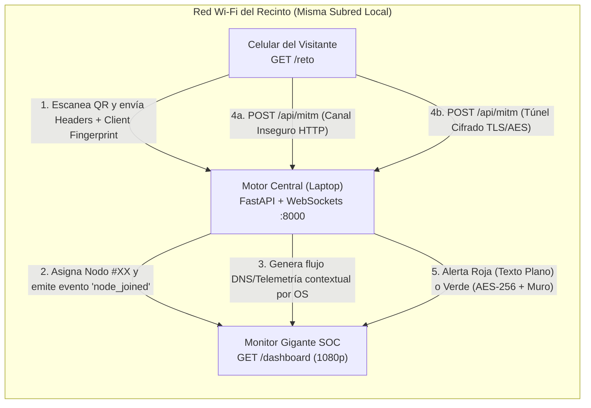

# Plan de Implementación: "El Rayos X del Wi-Fi Público: Lo que tu celular dice a tus espaldas"

## Descripción del Objetivo

Construir un laboratorio interactivo de auditoría y concienciación en vivo que simula un **Centro de Operaciones de Seguridad (SOC)** ejecutándose íntegramente en la laptop del expositor sobre el Wi-Fi del recinto, sin hardware adicional ni permisos de superusuario (`root`).

El sistema expone dos interfaces sincronizadas en tiempo real mediante **FastAPI + WebSockets**:
1. **Monitor SOC (`/dashboard`)**: Proyectado a 1080p en pantalla gigante con estética cyberpunk/SOC de alto contraste, código QR dinámico, radar en vivo, 3 columnas educativas (Huella Digital, Inspector DNS/Telemetría contextual + Modo Simulación de Pasillo, y Laboratorio Man-in-the-Middle Texto Plano vs. TLS/AES), efectos sonoros con Web Audio API y controles de expositor.
2. **Portal Interactivo del Visitante (`/reto`)**: Aplicación web móvil instantánea (cero fricción, sin instalaciones) donde el visitante ve su nodo asignado, descubre qué metadatos acaba de exponer su teléfono en 3 segundos, ejecuta la prueba de envío en texto plano (Botón Rojo) frente a envío cifrado (Botón Verde) y recibe las 3 recomendaciones clave de ciberseguridad.



---

## Arquitectura de Directorios a Construir

```text
rayosX/
├── requirements.txt
├── README.md
├── run.sh
├── server/
│   ├── __init__.py
│   ├── main.py              # Aplicación FastAPI, rutas HTTP (/dashboard, /reto, /api/*) y WebSocket (/ws)
│   ├── state.py             # Estado en memoria (nodos activos, historial MitM, muro protegido, métricas)
│   ├── fingerprint.py       # Analizador de encabezados HTTP + User-Agent + metadatos del cliente
│   ├── telemetry.py         # Motor contextual de consultas DNS/Telemetría por OS + Simulación de Pasillo
│   └── crypto_lab.py        # Simulador criptográfico real (SHA-256 / AES-CBC / TLS payload) y evaluación de riesgo
├── web/
│   ├── dashboard/
│   │   ├── index.html       # Pantalla Gigante SOC (3 columnas + barra superior + modal QR + controles)
│   │   ├── styles.css       # Tema oscuro de alto contraste 1080p, radar animado, alertas roja/verde
│   │   ├── app.js           # Cliente WebSocket, renderizado de las 3 columnas, atajos de teclado y Auto-Demo
│   │   ├── audio.js         # Sintetizador de efectos de sonido con Web Audio API (sonar, alerta roja, escudo verde)
│   │   └── qrcode.min.js    # Generador ligero de QR en SVG/Canvas 100% offline
│   └── portal/
│       ├── index.html       # Interfaz móvil para visitantes (/reto)
│       ├── styles.css       # Diseño mobile-first rápido, accesible y táctil
│       └── app.js           # Captura de metadatos del navegador, conexión WS/HTTP y laboratorio MitM
└── tests/
    └── test_server.py       # Pruebas automatizadas de API, fingerprinting, cifrado y WebSockets
```

---

## Componentes Detallados

### 1. Backend Ligero (`server/`)
- **`state.py`**: Estado en memoria (nodos conectados `#01`, `#02`..., métricas del Modo Presentador, historial MitM, Muro de Usuarios Protegidos y gestor de conexiones WebSocket).
- **`fingerprint.py`**: Lectura de encabezados HTTP (`User-Agent`, `Accept-Language`, `Sec-CH-UA*`) + datos del navegador móvil (resolución física, DPR, núcleos de CPU, GPU WebGL, idioma) e IP local anonimizada (`192.168.1.***`).
- **`telemetry.py`**: Motor contextual de consultas DNS y telemetría según el OS detectado (Android, iOS, Desktop) con categorización (`[RED SOCIAL]`, `[RASTREADOR PUB]`, `[TELEMETRÍA OS]`, `[MENSAJERÍA]`) + **Modo Simulación de Pasillo** automático.
- **`crypto_lab.py`**:
  - **Botón Rojo (HTTP / Texto Plano)**: Captura e inspección del paquete legible y disparo de alerta roja.
  - **Botón Verde (HTTPS / TLS 1.3 + AES-256)**: Cifrado con salida hexadecimal ilegible y registro del alias en el **Muro de Usuarios Protegidos**.
- **`main.py`**: Servidor FastAPI que sirve `/dashboard`, `/reto`, `/api/network-info` (detección multi-interfaz de IP para el QR), `/api/connect`, `/api/transmit`, `/api/demo/*`, `/api/reset` y `/ws/dashboard`.

### 2. Monitor Gigante SOC (`web/dashboard/`)
- **Diseño 1080p en modo oscuro de alto contraste** con 3 columnas:
  1. **Columna 1**: Radar circular animado en tiempo real + tarjetas de radiografía técnica por nodo.
  2. **Columna 2**: Consola en cascada de consultas DNS/Telemetría en segundo plano + indicador de Simulación de Pasillo.
  3. **Columna 3**: Laboratorio Man-in-the-Middle con alerta roja en pantalla completa para texto plano, escudo verde con bloque hexadecimal para tráfico cifrado y Muro de Usuarios Protegidos.
- **Herramientas de Expositor**:
  - Generador QR 100% offline con selector de IP/interfaz en vivo y modo zoom.
  - Efectos de sonido sintetizados con **Web Audio API** (sonar de conexión, sirena de alerta roja, acorde de blindaje verde) + botón de Mute.
  - Atajos de teclado: `Espacio` (Auto-Demo), `S` (Simular visitante/ataque), `M` (Mute), `F` (Pantalla completa), `R` (Resetear sala), `Q` (Agrandar QR).
  - Contadores de estadísticas del evento (Modo Presentador).

### 3. Portal Móvil del Visitante (`web/portal/`)
- Carga instantánea al escanear el QR (`/reto`):
  - **Paso 1**: Tarjeta con su número de nodo (`Visitante #08`) y los datos que su celular acaba de revelar.
  - **Paso 2**: Laboratorio interactivo con alias/contraseña ficticia (con botones de autocompletado rápido) y los dos botones: **Enviar sin cifrar (Rojo)** y **Enviar blindado TLS/AES (Verde)**.
  - **Paso 3**: Las 3 recomendaciones prácticas de ciberseguridad (HTTPS/TLS, DNS Privado DoH/DoT y uso de VPN/Datos móviles).
